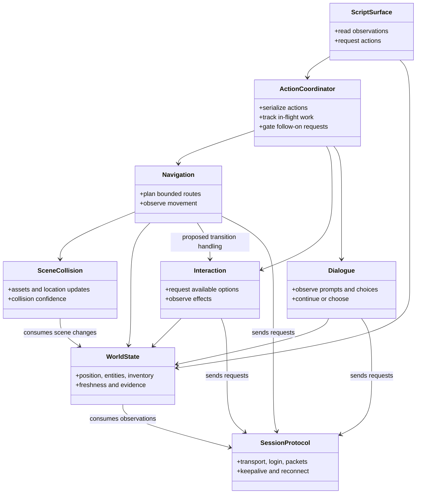
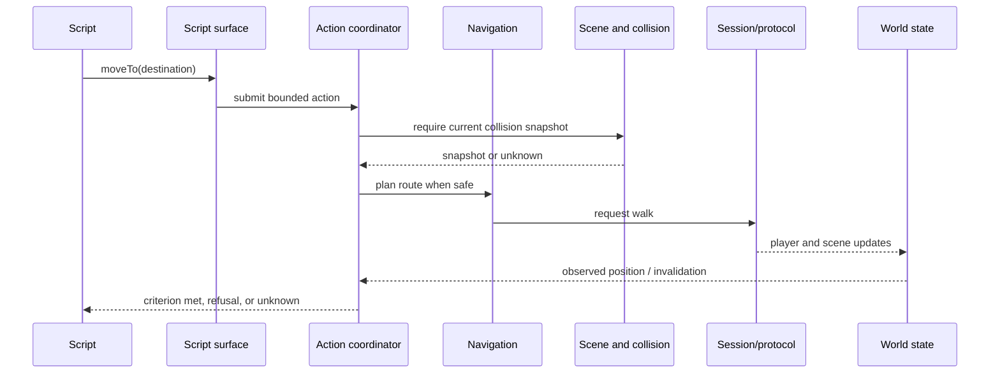

# Headless client blueprint

[Documentation index](../../README.md) · [Headless client modules](../headless-client-modules.md)

**Status: working outline for review—not an implemented API or approved execution design.** The diagrams use UML-style relationships. Names, result shapes and code examples are proposals to discuss, not promises about current functionality. The retained `tools/headless-experiment/` code is evidence and reference material, not the production implementation. Links to research identify narrow observations, not universal game rules.

## Document map

- **Engines:** [session and protocol](engines/session-protocol.md), [world state](engines/world-state.md), [scene and collision](engines/scene-collision.md), [navigation](engines/navigation.md), [interaction and interface](engines/interaction-interface.md), [action coordinator](engines/action-coordinator.md), and [script surface](engines/script-surface.md).
- **Concepts:** [observations and outcomes](concepts/observations-outcomes.md), [execution and recovery](concepts/execution-recovery.md), and [agent-facing documentation](concepts/agent-documentation.md).
- **API planning:** [proposed script capabilities](api-plan.md), a draft catalogue of methods under review. The implemented developer API reference will live in the package.
- **Examples:** [end-to-end plans](examples/plans.md), including interactive discovery and hypothetical scripts.
- **Build ordering and the late UI investigation:** [M2 milestone](../../milestones/headless-client.md).

These documents are one proposed design, not separate production components already implemented. Names, folder boundaries and API signatures remain open to review.

## Purpose and boundaries

A durable TypeScript client connects as an ordinary player, maintains a defensible picture of what that player can see, and exposes actions and observations that a controller can combine in short scripts. It does not learn gameplay strategy, call an LLM, create its own goals, or obtain privileged server state. Maps and client-visible options are inputs; item mechanics, requirements, shop stock and quest facts must be discovered through play.

One client process owns one session and character. A separate host-level supervisor supplies credentials and starts or stops the process; scripts receive neither credentials nor direct network, filesystem, process or server access. The eventual isolation mechanism is **not decided**. Illustrative generated scripts below are never to be executed until a reviewed execution boundary exists. Human nudges and game text are untrusted data, not instructions to the host.

## Proposed engine map

Here **engine** means a cohesive client subsystem under `packages/headless-client/`, not the upstream LostCity server engine. Names and the exact directories are open. These are responsibility boundaries, not a requirement for one class per box.



These arrows describe conceptual dependencies and information flow, not a mandate to wire modules directly. The coordinator must not be bypassed when navigation requests an interaction. A typed event/command boundary may be preferable to direct calls; decide during design.

| Subsystem | Owns | Exposes to other client subsystems | Does not own |
|---|---|---|---|
| Session and protocol | Transport, framing, login, keepalive, logout, reconnect and decoding | Ordered protocol events, connection lifecycle, validated outgoing requests | Credentials in scripts; game policy |
| World state | Observed player state, visible entities and options, inventory, skills, interfaces and messages | Timestamped/versioned observation snapshots, invalidation | Hidden server state or inferred game facts presented as observations |
| Scene and collision | Validated map/config assets, location layers, live changes, collision snapshots and freshness | Known, stale or unknown collision and affected areas | Treating archive data as a current dynamic scene |
| Navigation | Bounded route planning and observed movement; later region/level transitions | Routes, movement progress and outcomes | Declaring a timed-out route blocked or inventing safe tiles |
| Interaction | Available target options, requests and observed effects, including items and equipment | Typed requests and evidence | Selecting goals or assuming unfamiliar actions have known meanings |
| Dialogue | Current observed prompt, continue and choice controls | Dialogue observations and bounded choice/continue requests | Assuming close means a quest or conversation completed |
| Action coordinator | One active mutating action, action lifecycle, cancellation attempts and post-uncertainty gating | A single action contract and safe admission decisions | Claiming a timeout cancelled a server action |
| Script surface | Minimal observations and actions supplied to the controller | The reviewed script capability contract | Login, credentials, raw packets or hidden data |

Dialogue could be a separate subsystem or part of interaction; its own box makes choice handling visible without deciding a class boundary. Asset acquisition can be its own module. Fleet management, scheduling, long-term memory and model calls are outside this client.

## State and action contracts to settle

### Observations

A query distinguishes three states rather than using a missing value as a fact:

```ts
type Observation<T> =
  | { status: 'known'; value: T; observedAt: string; revision: number }
  | { status: 'stale'; reason: string }
  | { status: 'unknown'; reason: string };
```

This is a discussion shape for the underlying state and explicit inspection APIs: choose the clock, revision semantics, evidence identifiers and serialization later. An agent-facing helper can hide the wrapper when that makes scripts clearer. For example, `inventory.find(name)` may return an item or `null` **only when the relevant inventory snapshot is known and current**. If it is stale or unknown, the proposed host stops that script with a structured `unknown` result instead of returning `null`; the exact error/result mechanism is open. A `known` empty list means the observation actually established an empty list in its defined scope; `unknown` or `stale` never means empty. An object handle is valid only in its observed scene revision; the coordinator must revalidate it and its option immediately before use. A previously observed target can move, disappear or become stale.

### Actions

A request, an observation, and an interpretation are separate. For planning, use `completed` only when the **declared completion criterion** is observed, `refused` only with a correlated explicit refusal, and `unknown` when observations do not settle the outcome. Whether `refused` is a distinct public variant is open. A generic interaction without a domain-specific criterion can establish that an observable change followed a request, not that a goal was achieved or that the request caused every concurrent change.

| Proposed result | What it says | What it does not say |
|---|---|---|
| `completed` | The stated observed criterion was met | The wider goal is complete |
| `refused` | A relevant refusal was observed and attributed with sufficient confidence | Every future attempt will fail |
| `unknown` | The criterion could not be established | The action failed, is blocked or has stopped |

At most one mutating action is in flight per character. An `unknown`, disconnect or expired observation closes the gate for unsafe follow-on actions until the host has reconciled or otherwise established a safe state. A plain walk interrupted particular tree interactions in [21](../../research/headless-client/21-cancelling-and-legs.md); it is a possible cancellation request, not proof of universal cancellation. A deadline only stops waiting. If a session is lost, old observations become stale or unknown, a new session constructs fresh state, and any earlier action remains unresolved unless new evidence settles its criterion ([24](../../research/headless-client/24-reconnect-and-scene.md)).

### Navigation and interaction

`moveTo` is a bounded walk over a sufficiently fresh collision snapshot. `navigateTo` is a later, higher-level operation that may use several walks and supported transitions; `exploreTo` uses the same navigation machinery with richer reporting of observations made during travel. Both continue processing safety-relevant world updates, and both must fail closed when the scene, route, destination or transition is unknown. Reporting details and actual processing costs remain to be designed and measured. A targeted interaction may require an operation-click approach followed by the target request, as observed in one tree case ([20](../../research/headless-client/20-world-object-tree.md)); don't generalize that sample into a universal server routing rule.



If the snapshot is missing, invalidated or outside supported coverage, no walk is sent. For long routes, choose bounded legs from verified protocol limits and observed positions; 57 tiles and 24 waypoints were observed in specific tests, not proven universal limits ([21](../../research/headless-client/21-cancelling-and-legs.md), [22](../../research/headless-client/22-cross-region-navigation.md)). A scene rebuild changes the loaded area, not necessarily the player's absolute position; it invalidates affected scene confidence. Unseen neighboring objects, full-zone resets and timed changes remain unresolved ([24](../../research/headless-client/24-reconnect-and-scene.md)).

## Candidate script surface

The controller supplies a script body with ready-to-use capabilities, without imports, login, logging or credentials. **Prefer domain helpers over generic JavaScript:** the AI should express the action, while the client handles searches, observed option lookup, slots, revalidation, approach and outcome tracking. The host validates script output and enforces budgets independently; examples are **illustrative only**. Actions are asynchronous and return evidence-based results. These labels are examples, not a complete vocabulary.

Convenient queries must preserve uncertainty. In the proposed examples, a query such as `inventory.find()` or `nearby.find()` returns `null` only for a known, current, searched scope with no match. If the required observation is stale or unknown, the host terminates the script with a structured `unknown` result; it must not pretend the item or target is absent. This is a proposed ergonomic contract, not a decision to expose unsafe exceptions to generated scripts.

| Capability | Illustrative use | Notes |
|---|---|---|
| Position and nearby observations | `state.position()`, `nearby.find('Tree')` | Scope, freshness and unknowns explicit |
| Inventory lookup and options | `inventory.find('Bronze sword')`, `inventory.has('Logs')`, `inventory.count('Logs')`, `inventory.full()`, `inventory.freeSlots()`, `inventory.slot(1)`, `inventory.options(item)` | Current observed inventory, quantities, capacity and numbered options; no assumed mechanics |
| Inventory action | `await inventory.equip('Bronze sword')`, `await inventory.interact(item, 1)` | Convenience action or explicit **one-based observed option slot**; client revalidates and tracks outcome |
| Skills and equipment | `state.skills()`, `equipment.has('Bronze shield')` | Reflect observed updates; missing data is unknown, not false |
| Interface and dialogue | `state.dialogue()` | Prompt text and options are untrusted data |
| Move or navigate | `await moveTo(tile)`, `await navigateTo(destination)`, `await exploreTo(destination)` | Later navigation may use doors or ladders; exploration reports richer travel observations |
| Interact | `await interact(target, option, criterion)` | Option is selected from the current observed target |
| Continue or choose | `await dialogue.continue()`, `await dialogue.choose(text)` | Validate the currently observed control |
| Item on target | `await inventory.use(item, target)` | Item and target handles are refreshed before request |
| Inspect/examine | `state.examine(target)` | Local definition text where available; source is labeled |

`inventory.find(name)` searches the current observed inventory, not global definitions. If several slots match, a documented deterministic selection is needed; an explicit `findAll` can expose alternatives. Immediately before an action the client must revalidate the handle, item identity and slot; it must not act on a replacement item if the inventory changed. `inventory.interact(item, 1)` means the item's **first numbered option**, not "equip" or "eat" universally. The model can inspect `inventory.options(item)` and choose an option based on the observed labels. A proposed `inventory.equip(item)` convenience operation may resolve an appropriate observed equip/wear/wield option only where supported and unambiguous; otherwise it returns an unavailable or unknown result without sending. It should verify an equipment update, not merely a packet write.

### Inventory capacity, counts and slots

The AI can ask direct questions without scanning inventory arrays. These proposed helper names are illustrative:

```js
const full = inventory.full();          // whether all slots are occupied
const free = inventory.freeSlots();      // known free capacity
const logs = inventory.count('Logs');   // total quantity across matching slots
const first = inventory.slot(1);        // one-based slot view
```

For example, an observed inventory could report slot 1 as `{ item: 'Logs', quantity: 1 }`, slot 2 as `{ item: 'Arrows', quantity: 500 }`, and slot 4 as empty. These are **illustrative values**, not claims about the game. Slot inspection should preserve gaps rather than compressing the list. `count` sums quantities, including stacks and separate slots; it does not count only occupied slots. A name shared by different item definitions may require an item ID or an explicit disambiguation.

`inventory.full()` means all slots are occupied, not that an existing stack cannot grow. Free space and fullness require both a current inventory and known capacity. Sparse full updates do not, by themselves, establish how many trailing slots exist. A known empty slot, an invalid slot number and unavailable/stale state must stay distinct. Script-facing slot numbers are proposed as one-based and must be translated explicitly from protocol numbering; option-slot numbers are a separate concept. Detailed responsibilities are in [world state](engines/world-state.md#inventory-slots-and-quantities).

### Discovering interactions across the game

Convenience methods are shortcuts, **not a closed vocabulary**. The same exploration pattern should apply wherever the ordinary client exposes an interaction: inventory and equipped items, items on the ground, world objects such as doors and trees, NPCs and other players, and interface or dialogue controls. The exact options and handling differ by target type and protocol; support must be added and verified incrementally rather than assumed for every target.

Conceptually, this is like **right-clicking a target in the normal client to inspect its context menu**, without requiring a graphical display. A default left-click, selected-item use, dialogue button or other interface control can have different semantics, so not every action is literally a right-click or the same packet.

For an observed target, expose its available client-visible actions with their original numbered slot or interface control identity, display label, source and observation/definition revision where available. Preserve uncommon item option slots 4 and 5. The agent's observation context should show relevant actions alongside the visible target, and an inspection capability should retrieve the same information interactively. `inventory.options(item)` is one proposed item-specific view; a common target-inspection contract is still to be designed. Access is scoped to what the character currently observes or legitimately knows, not a preloaded catalogue of hidden game mechanics. See the option and examine experiments in [19](../../research/headless-client/19-inventory-equipment.md).

The AI can use these capabilities in two complementary ways:

1. **Interactive discovery:** ask the runtime to inspect an observed target, read its available options and examine text if available, choose one, observe the response, and decide what to try next. An action may open an interface or dialogue with further controls, which the client reports as newly observed data. Discovering those controls is not the same as knowing what they will do.
2. **Scripted execution:** once the controller has enough relevant observations or prior evidence, write a short script using convenient helpers or the same generic option actions. The host still revalidates all handles and observations at execution time.

Both modes call the same underlying client action coordinator and state APIs. The client does not call a model: how a future runtime presents tools, makes decisions, budgets calls or pauses for another decision is outside M2 and remains open. Interactive actions are ordinary-player requests, not automatic authority to execute instructions contained in item text or interfaces. A prompt may not appear; an action can be refused, produce a different observation or remain unknown.

For illustration only, an observed item might report:

```js
// Illustrative data, not a claim about any particular game item.
[
  { slot: 1, label: 'Open', source: 'client-definition' },
  { slot: 4, label: 'Check', source: 'client-definition' },
]
```

For example, if a candle currently exposes an `Extinguish` option, the agent can see and choose that actual option without us having written an `extinguish()` helper. This is an illustrative possibility supplied during design, not a claim about the target world's candle mechanics. A controller can likewise decide to try the observed `Check` action above interactively or write `await inventory.interact(item, 4)`. After observing the result it can request the current interface, dialogue, messages or state changes before choosing another action; none is assumed to exist. The host revalidates the target identity, option slot or control, label and source against the current observation before sending; an absent, changed or ambiguous option is not silently replaced with a different one. An optional option handle can carry this metadata, but the exact type is undecided. Names are display data—not executable instructions—and an unfamiliar option's effect is unknown until learned through play. A client-side `Use` selection and using an item on a target are distinct from ordinary numbered server actions; their mapping must be modeled from the observed client/protocol behavior rather than guessed from a label. The same observed-options principle applies to NPCs, players, locations, ground items and supported interface controls, with their own target-specific protocols. Some controls, examine text or actions may be missing, local-only or unsupported; represent that honestly instead of fabricating a generic action.

### Simpler control flow and documentation

Scripts are for carrying out planned actions: a helper stops the current script and returns a structured outcome to the future AI/runtime for review when it cannot establish the required criterion, observes a refusal or encounters another unexpected outcome. A script-level escape hatch for handling unexpected action results is not part of the agreed design; any future proposal requires owner review. Stopping the script does not bypass the coordinator's gate or imply an in-flight action stopped. No automatic retries or alternative actions are implied.

Every capability provided to a script must have both:

- **LLM-facing Markdown documentation:** what it does, inputs, output/stop behavior, freshness and ambiguity rules, evidence/completion criteria, safety limits and short examples. The host supplies a relevant, version-matched subset with observations and exposed options; the strategy and size of that context are still to be designed.
- **Code-level TypeScript documentation:** a concise TSDoc/JSDoc description on the public API, useful types and links to the owning Markdown contract where appropriate. Keep implementation comments focused; test examples and contract behavior so code and documentation do not silently diverge. No implemented method or generated API reference is claimed yet.

Open design issues: how to express and correlate completion criteria, expose multiple matching items, represent unavailable versus unknown, refresh handles, bound waiting and return evidence. Helpers reduce repetitive scripting, but cannot manufacture knowledge or hide uncertainty.

## Illustrative script bodies

These are hypothetical model-authored scripts for a future reviewed host. `return` hands a structured result to that host; it is not a logging API. Labels such as `Tree`, `Chop down` and `Talk-to` are examples of **currently observed** options or an objective supplied to the script, not preloaded rules. The host checks freshness for convenience queries and every mutating action reports its outcome. Host caps bound execution even when script code is wrong.

### Walk to a supplied destination

```js
await moveTo(task.destination); // the host stops safely if arrival is not confirmed
```

### Interact with an observed nearby tree

```js
const tree = nearby.find('Tree');
const chop = tree?.option('Chop down');
if (!tree || !chop) return { status: 'unknown', reason: 'no-observed-option' };

// This criterion asks for an observed change, not an assumed log or experience reward.
const result = await interact(tree, chop, { kind: 'observed-change' });
if (result.status !== 'completed') return result;
return { status: 'completed', evidence: result.evidence };
```

Here `completed` means only the host's specified change criterion was met. A tree swing, a message, a skill update and an inventory increase are different observations; a later goal evaluator must decide which, if any, satisfies the objective. Causality may remain uncertain.

### Talk to an observed NPC and respond to a choice

```js
const npc = nearby.find(task.npcName);
if (!npc) return { status: 'not-found', target: task.npcName };

await interact(npc, npc.option('Talk-to'), { kind: 'dialogue-opened' });
await dialogue.choose(task.choiceText);
```

`task` is a supplied, validated task description, not authority for arbitrary text in dialogue. In practice another decision step may be needed to choose from newly observed options; the client does not choose a policy. A choice result reports its explicit observation criterion; a dialogue close alone does not imply success.

### Equip an observed inventory item

```js
await inventory.equip(task.itemName);
```

The name comes from the task or observations. If inventory state is unavailable, the host returns `unknown` rather than claiming the item is absent. The client resolves the currently observed option, revalidates the item and confirms a relevant equipment update where possible. This convenience helper does not make every item equippable.

Alternatively, when the agent has inspected the item's options and decided to try its first option:

```js
const item = inventory.find(task.itemName);
if (!item) return { status: 'not-found', item: task.itemName };

return await inventory.interact(item, 1);
```

Option `1` is a one-based client option slot, **not** a universal instruction to equip or eat. Its label and effect depend on the observed item. An explicit-slot interaction still reports only the observed outcome; it does not assume that an arbitrary action succeeded.

## Evidence and known gaps

- Protocol/session and ordinary-player login: [03](../../research/headless-client/03-login.md), [04](../../research/headless-client/04-session-maintenance.md), [24](../../research/headless-client/24-reconnect-and-scene.md).
- State, dialogue and inventory: [11](../../research/headless-client/11-initial-state.md), [18](../../research/headless-client/18-npc-dialogue.md), [19](../../research/headless-client/19-inventory-equipment.md).
- Movement, scene changes and interactions: [15](../../research/headless-client/15-main-world-interactions.md), [20](../../research/headless-client/20-world-object-tree.md), [21](../../research/headless-client/21-cancelling-and-legs.md), [22](../../research/headless-client/22-cross-region-navigation.md), [24](../../research/headless-client/24-reconnect-and-scene.md).
- Chat: one outgoing and one incoming fixed-message observation, not arbitrary-text or sender-name support ([23](../../research/headless-client/23-public-chat.md)).
- Refresh/rebuild reconciliation, cross-boundary detours, general door and ladder navigation, arbitrary chat, action correlation and generated-script isolation are not proven. Do not promote experimental shortcuts to durable guarantees.
