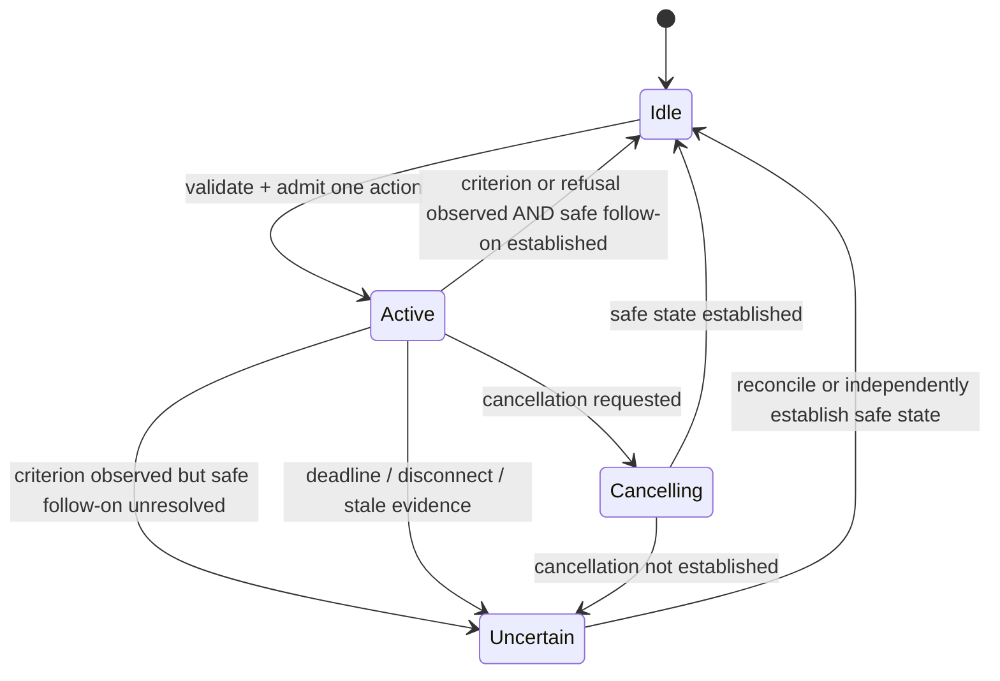

# Action coordinator

[Client blueprint](../README.md) · [Observations and outcomes](../concepts/observations-outcomes.md) · [Execution and recovery](../concepts/execution-recovery.md)

**Status: proposed.** The coordinator owns admission and evidence tracking for mutating actions in one character session. It is not a goal planner and does not prove the server stopped when a caller stops waiting.

## Lifecycle

The exact state machine, cancellation signal and evidence that safely permits a new action are open design decisions. In particular, an explicit refusal must be correctly attributed and may not establish the state of an older request. A single coordinator must own nested navigation/interaction steps; a door transition is not a second competing action admitted behind the coordinator's back.

## Rules

1. Validate permissions, session, relevant current observations, target identity and option before any request. An unsupported or stale action sends nothing.
2. Assign an action ID and declare the completion criterion, bounded observation window and relevant evidence scope. Preserve request, observations and outcome separately. IDs, clock and persistence formats are not yet specified.
3. Permit one mutating action at a time. Expose progress, explicit refusal when sufficiently correlated, `completed` only when its criterion is observed, or `unknown` when evidence is insufficient. Other actors can change the world concurrently; an observed change alone need not prove causality.
4. On deadline, disconnect, lost packet, stale scene or interruption, stop waiting and gate unsafe follow-on actions. Request cancellation only through a supported ordinary-player action and observe its effect; a plain walk interrupted particular tree actions, not every possible activity. Do not infer server-side cancellation from timeout or logout.
5. Reconcile after a reconnect using fresh observations and the unresolved action criterion, without carrying stale state forward. If safety cannot be established, return control to the operator/controller with an unresolved outcome rather than performing speculative recovery.

Scripts stop on refusal, uncertainty, unavailable prerequisites or other unexpected outcomes and report structured evidence to the future AI/runtime for review. A script-level escape hatch to handle unexpected action results is not part of the agreed design; any future proposal requires owner review. Stopping does not authorize an automatic retry or another option, and reporting the result does not bypass the safe-follow-on gate.

### Interaction conditions and observed changes

Use a combination of conservative, documented defaults and caller-selected observation conditions. A default may wait for a supported interaction-specific response, such as an observed dialogue opening, but does not claim that a conversation or quest is complete. The caller can instead choose reusable conditions based on observable state—for example, that a selected target changes or the inventory becomes full—without writing polling loops. Exact syntax, default criteria, evidence attribution and behavior when multiple conditions match remain open. These helpers must not encode unverified or preloaded game mechanics.

An interaction result should include a structured, bounded summary of relevant **observed changes** over a defined interval, alongside its outcome, observed condition and any separate safe-follow-on status. For example, inventory quantity changes, a world object disappearing and another appearing at its tile, NPC appearances/disappearances, dialogue and messages may all be reported when available. Snapshots and deltas must distinguish unknown or missing data from zero, preserve source and freshness, and explicitly report gaps or truncation. Co-occurring changes are not automatically caused by the request or proof that two NPC identities are the same. Report useful changes even when the interaction's outcome is `unknown`; an observed change alone does not prove the activity stopped or admit the next mutation.

While an action remains in progress, emit bounded progress observations to the future runtime and Control Center where supported—for example, an observed inventory or experience change. Progress is neither completion nor proof of causal attribution or safety to issue the next action, and routine progress alone does not stop the script or trigger a model call or public chat. An unexpected result or urgent supported observation follows the stop-and-inform policy. Define reporting frequency, event ordering, attribution, retention, coalescing and gap/overflow signaling before implementation; the final result summarizes the observed interval separately.

The owner describes tree chopping as potentially producing several logs until the tree expires or inventory is full, and ore mining as one-and-done. Treat this as owner-provided game-behavior guidance, not verified general client evidence or a hardcoded rule; the client must use observed evidence and caller-selected criteria. Relevant experiments are indexed in [tree research](../../../research/headless-client/20-world-object-tree.md).

## Verification

Use fake clocks and sessions for concurrent submissions, refusal attribution, progress without completion, stale handles, deadline while server movement continues, cancellation attempts, disconnect, fresh-session reconciliation and late outcomes. Reproduce representative ordinary-player behavior against the shared server. Previous findings: [17](../../../research/headless-client/17-multi-action-session.md), [21](../../../research/headless-client/21-cancelling-and-legs.md), [24](../../../research/headless-client/24-reconnect-and-scene.md).
