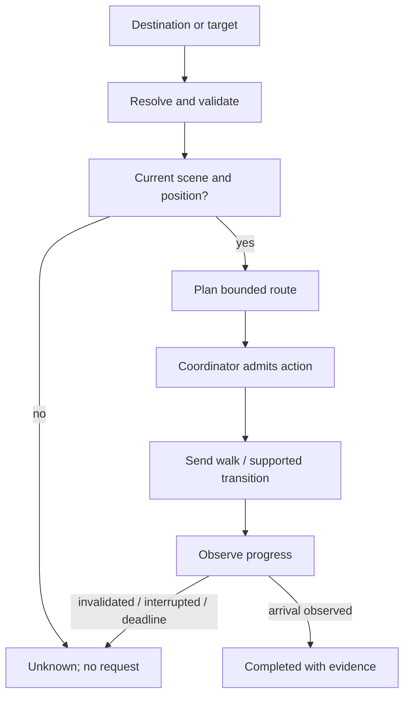

# Navigation engine

[Client blueprint](../README.md) · [Scene and collision](scene-collision.md) · [Action coordinator](action-coordinator.md)

**Status: proposed.** Navigation converts a supplied destination or observed target into bounded ordinary-player actions, using current evidence. It does not decide the character's goals or teleport. A script expresses intent; it should not manage packet waypoints.

## Candidate capabilities

- `moveTo(tile)`: bounded movement over supported, current collision coverage. It reports arrival only when an appropriate position update establishes the criterion.
- `navigateTo(destination)`: later higher-level orchestration over multiple bounded legs and supported transitions, with compact routine reporting.
- `exploreTo(destination)`: the same underlying travel and safety machinery with richer reporting of observations encountered along the route. This is not a separate pathfinding engine. Exploration without a supplied destination is a distinct future task.

For either command, a destination may eventually be a tile, area or permitted map label; label availability and ambiguity handling are not established.
- An interaction may request an approach to a specific observed target. The client verifies its current location and reach conditions before and during the approach. The agent may supply an allowed target area and, separately, a permitted travel area; these are not interchangeable. The client must not substitute another target or leave a supplied boundary to complete the action without authorization. If no safe supported approach satisfies the constraints, report `unknown` or a clearly evidenced constraint result rather than widening the area. Movement to interact can require a distinct operation-click sequence; one observed tree case is not a universal rule.

Names and exact signature are illustrative. A route is based on a snapshot/ticket from [scene and collision](scene-collision.md), current position and supported movement rules. Unknown coverage, unsupported level/shape/transition or ambiguous destination stops with `unknown`; no route found in a model is not proof that the game destination is unreachable. Keep coordinates and floor distinct from a human-supplied label.

## Planning and progress

1. Resolve the destination using only permitted map information or observed handles. Revalidate moving or disappearing targets.
2. Obtain a current position and collision snapshot covering the route, including edge effects from neighboring regions. Plan bounded steps and compress them into protocol-supported waypoints; cap packet and action duration using verified implementation constraints, not assumptions from a single walk.
3. Submit the movement through the coordinator. Compare subsequent position updates to the intended progress and declared arrival criterion. Track evidence and elapsed time; absence of progress or a timeout is not, by itself, a definitive block or a cancellation.
4. On scene invalidation, unexpected position, refusal, disconnect or action deadline, stop issuing follow-on requests and report the reason. Replan only after the coordinator admits it against a reconciled, sufficiently fresh state; retries and detours must be bounded. Do not send a compensating move on an unresolved prior request merely because the caller stopped waiting.
5. Later, represent a door, ladder or level transition as a supported interaction with an explicit observed precondition and postcondition. Ask the same coordinator to execute the transition; never nest a second independent action that bypasses the one-action rule. Unsupported transitions remain unknown, not automatic clicks.

## Observations during travel

Navigation must not make the character blind while an action is in progress. Normal player-visible scene and interface updates continue through [world state](world-state.md) while a route runs. Newly observed targets, signs or permitted map labels can be surfaced as attributed observations to the runtime; a route result may reference relevant observation evidence, but arrival is not the only useful output. For example, a shop label or readable sign might be noticed while walking through town **if it is actually available in permitted map or client-visible data**. A building's shape alone must not be promoted to a verified shop, and a shop label does not reveal stock, prices or services.

Both commands continue processing ordinary-client updates needed for state and safety. `navigateTo` normally surfaces compact travel progress and important safety changes, while `exploreTo` requests richer incidental observation reporting. Quiet reporting does not mean no observations occurred. The client reports observations and their scope, source and freshness; the future runtime decides whether they merit interrupting the current task, recording evidence for later or simply continuing. It must not execute incidental text as instructions. Streaming or bounded batches may be used, but ordering, backpressure, coalescing, retention, loss/overflow signaling, privacy, report limits and decision cadence are open design choices. Rich reporting may increase client-side selection work and AI context/token costs; neither mode eliminates the need to receive and process safety-relevant updates. Measure the actual overhead rather than assuming a saving. Missing or dropped observations must not be reported as an empty scene. Persistent discoveries belong to later Event History and Discovery Memory, not to navigation itself.

An observation alone does not cancel or redirect a walk. If the runtime chooses to investigate, it must request an interruption and wait for the coordinator to establish a safe point before a new mutating action. Whether a long action can be paused, and how decisions are resumed without unsafe overlap, requires design and testing.

## Scope, acceptance and open questions

M2's first slice can be a short same-region walk, with the M4 milestone owning broader destination-driven navigation and exploration. The exact client/runtime ownership of map planning is a design decision: avoid duplicating competing navigation authorities across packages.

Test obstacle-free and detour paths, edge walls and footprints, unavailable neighboring data, snapshot invalidation while planning/walking, waypoint and signed-offset boundaries, movement interruption, refusal, target movement and reconnect. Live tests must require observed arrival, and compare planned versus observed trace. Existing experiments cover narrow cases only: [12](../../../research/headless-client/12-routefinding.md), [15](../../../research/headless-client/15-main-world-interactions.md), [21](../../../research/headless-client/21-cancelling-and-legs.md), [22](../../../research/headless-client/22-cross-region-navigation.md) and [24](../../../research/headless-client/24-reconnect-and-scene.md). General dynamic reconciliation and cross-region detours remain open.
