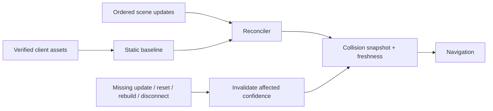

# Scene and collision engine

[Client blueprint](../README.md) · [Navigation](navigation.md)

**Status: proposed; dynamic reconstruction remains unproven.** The purpose is to provide collision information with explicit coverage and confidence—not to promise that static map archives describe the live world.

## Inputs and outputs

Acquire permitted client map terrain, location placements and referenced definitions from ordinary client interfaces; validate advertised checksums/version and record the source revision. Convert supported terrain, wall edges, rotated footprints, levels and bridge/link rules into a collision representation. Missing or corrupt assets, unsupported shapes, missing definitions, unloaded neighboring regions and unknown dynamic changes must not silently become walkable.

Merge ordered live location additions, replacements, removals and relevant zone notifications with the static baseline only when their semantics and layer identities are known. Account for overlapping objects, footprints extending across region boundaries, temporary/timed changes, dynamic doors, floor transitions and conflicting observations. Provide navigation an immutable snapshot/ticket with coverage, level, revision and invalidation reasons; the exact structure is open.

## Invalidation and recovery

Track continuity from before capture through use. A relevant change can invalidate an in-flight calculation or route; a full-zone refresh, scene rebuild, level change, unknown timed merge or protocol loss is not itself proof of the resulting live scene. Rebuild only when enough evidence is available to reconcile the affected coverage. Until then, return `stale`/`unknown`, never a guessed open tile. Define how zone resets relate to current dynamic overlays before claiming reconstruction.

[24](../../../research/headless-client/24-reconnect-and-scene.md) projected one observed stump replacement onto a static baseline and separately observed refreshes; it did **not** reconstruct a dynamic scene after refresh. [22](../../../research/headless-client/22-cross-region-navigation.md) demonstrated a straight cross-region control; it did not account for all surrounding-region footprints. These are design inputs, not production guarantees.

## Tests and open decisions

Use synthetic seam walls/footprints, layered and overlapping changes, rotations, zone reset, rebuild, lost packets, timed changes and assets missing from a neighboring region. Assert that a stale ticket cannot authorize a new route. Then perform controlled live changes and compare against ordinary player observations; absence of movement alone does not prove collision. Decide asset retention, maximum supported coverage, source/version validation and a conservative treatment of unsupported overlays before navigation depends on this engine.
