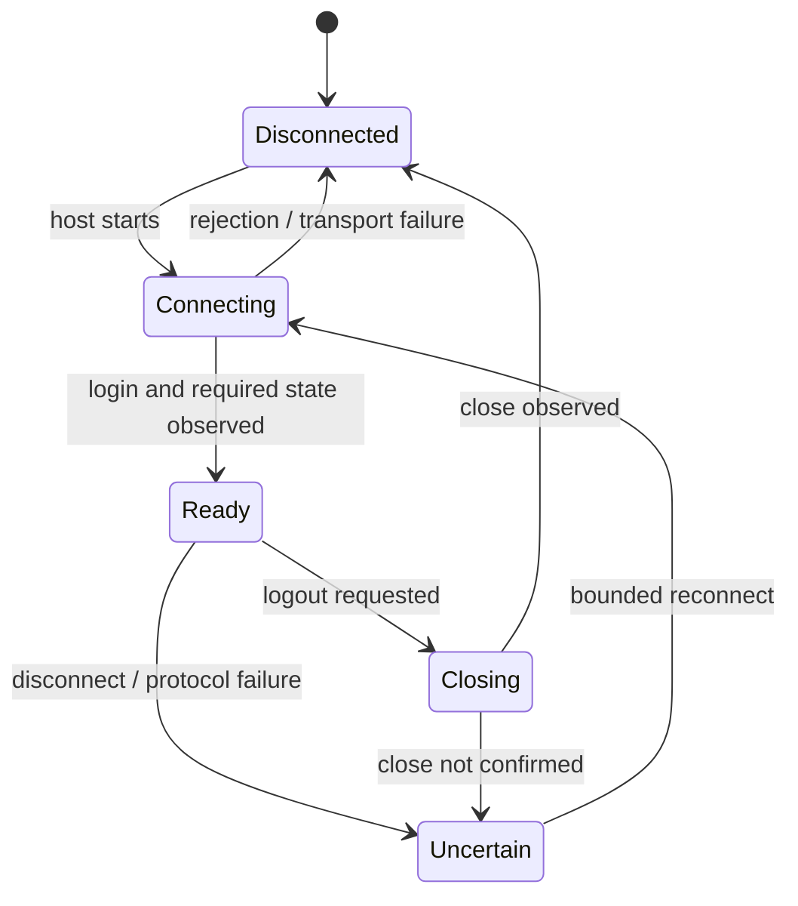

# Session and protocol engine

[Client blueprint](../README.md) · [Execution and recovery](../concepts/execution-recovery.md)

**Status: proposed responsibility boundary, not an implemented API.** One client process owns one ordinary-player session. A host-level supervisor provides credentials and configuration and manages the process; scripts receive neither. Do not add model calls, privileged game-state access or server changes.

## Responsibilities

- Validate connection inputs; acquire Revision 274-compatible bootstrap data through ordinary client endpoints, validate integrity and record the relevant revisions. Define cache eviction, integrity and retry policy before relying on cached assets.
- Establish transport, perform login and frame, encrypt/decrypt, encode and decode supported game packets. Translate malformed, unknown or unsupported data into a bounded protocol/observation failure rather than inventing state. Sequence ordered incoming events for state consumers.
- Maintain keepalives, observe server closure, request clean logout and report whether closure was actually confirmed. Do not infer that logout cancels a previously sent action.
- On disconnect notify the coordinator and invalidate session-scoped observations. Reconnect with bounded backoff and fresh state, respecting account/device/server throttles. A rejected login, transport failure and timeout are different observations; do not automatically attribute their cause.

## Lifecycle and collaboration

`Ready` needs an explicit minimum-state definition for the action being admitted; accepted login alone does not imply all inventory, scene or interface state is known. On a new session, allocate a new session identity and fresh trackers; do not revive the old world snapshot by copying it. The coordinator owns unresolved action status and decides whether new evidence settles it. The session reports packets and connectivity, not gameplay success.

## Acceptance and open decisions

- Offline: fragmented framing, cipher vectors, rejected login, keepalive, malformed packets, timeout, logout and bounded retry using fake transport and clocks; no credentials or network required.
- Live: one ordinary-player login, observed minimum state, controlled loss, fresh reconnection and clean logout against the one shared server. A past control observed the destination after reconnect but could not pinpoint when movement occurred ([24](../../../research/headless-client/24-reconnect-and-scene.md)).
- Decide transport support, retry defaults, asset-cache ownership, compatibility/version checks and the durable ISAAC implementation. The attributed experimental cipher is reference material; no production choice is implied. No credentials, raw login payloads or player-identifying chat in diagnostic output.
