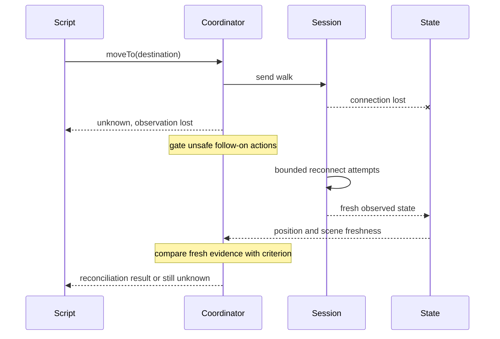

# Headless client: illustrative end-to-end plans

[Documentation index](../../../README.md) · [Client blueprint](../README.md)

**Status: illustrative planning examples, not implemented capabilities or game facts.** Locations, names and outcomes below are examples of information supplied by a task or observed during a particular session. They are not a preloaded mechanics guide. Scripts are hypothetical; generated code must not be executed until its isolation and capability boundary have been separately reviewed.

## How to read these plans

Each example follows the same proposed path:

1. A controller receives a bounded task and current observations, then chooses what to try. Model use is future work; M2 does not call a model.
2. A host gives a short script only the approved observations and capabilities. Credentials, packets and server administration stay outside it.
3. The coordinator admits one mutating action, and the relevant client subsystems send ordinary-player requests and observe updates.
4. The result states the declared completion criterion and available evidence. A higher layer decides whether the task is complete; it does not turn an unknown into a fact.

The host must enforce budgets, time limits, action concurrency and safe follow-on behavior independently of the script. Proposed lookup helpers return `null` only when a known, current scope was searched and no match exists; unavailable observations stop the script with `unknown` instead. The proposed default also stops on an unresolved or refused action; the explicit checks below show the outcome boundary but may be unnecessary with that default. An opt-in way to inspect a result must not bypass the coordinator's safety gate. These examples propose a surface; exact types, validation and execution isolation remain open.

## Plan A: walk to a supplied point and return

**Task:** From the current position, visit a supplied same-level destination, then return to the starting point. A map label or coordinate may be supplied; it must be available to the player, not privileged state.

**Preconditions:** A live session, known current position, a fresh supported collision snapshot covering the bounded route, and an admitted action. No assumption that stale or missing regions are open.

```js
const start = state.position();
if (start.status !== 'known') return { status: 'unknown', reason: 'start-position' };

const outward = await moveTo(task.destination);
if (outward.status !== 'completed') return outward;

const back = await moveTo(start.value);
if (back.status !== 'completed') return back;
return { status: 'completed', evidence: [outward.evidence, back.evidence] };
```

**Front to back:** The host validates `task.destination`; the coordinator checks action admission; navigation plans from the current supported scene; the session sends a walk; subsequent player updates establish or fail to establish arrival. Only after the first arrival is observed may the second action start. The host returns both legs' evidence.

**Stop cases:** No route in the current snapshot is `unknown`, not proof the destination is unreachable. A timeout, disconnect or scene invalidation also produces `unknown`; it does not establish cancellation, and the host blocks unsafe follow-on actions. The existing trusted A → B → A control demonstrates one session, not general navigation ([17](../../../research/headless-client/17-multi-action-session.md)).

### Variation: notice something while walking

With a proposed `await exploreTo(task.destination)`, the same navigation machinery makes richer incidental observations available than the compact `navigateTo` default. During either outward walk, the client continues processing ordinary-player observations. Suppose it receives a visible, readable sign or a permitted map label that identifies a shop. The state/event stream may report the label, its location, source, observation time and freshness to the future runtime. The runtime may continue to the original destination and retain the observation for later, or decide to investigate after coordinating a safe interruption. No model call or memory implementation is assumed in M2.

This is illustrative: the discovery experiment has not established which shop labels or signs the headless client can currently obtain. A visible shop label is not evidence of stock, prices or an available service. If an event stream is unavailable, has gaps or overflows, that loss must be explicit; no observation is not proof that the route passed nothing interesting. The walk does not stop merely because a label appeared.

## Plan B: attempt an observed tree interaction and assess the result

**Task:** Try one currently observed `Chop down` option and report whether a specified inventory change was observed. The task's target item description comes from supplied context or a previous observation; the client does not preload what a tree should yield.

**Preconditions:** Known nearby targets, a currently observed option, a known inventory snapshot and a supported interaction approach. The controller must supply an expected item ID only if it has a valid source for that expectation; otherwise it should ask for a generic observed-change report and not claim a particular item was gained.

```js
const before = inventory.checkpoint();
const tree = nearby.find(task.targetName);
const option = tree?.option(task.optionLabel);
if (!tree || !option) return { status: 'unknown', reason: 'option-not-observed' };

const result = await interact(tree, option, {
  kind: 'inventory-increase',
  itemId: task.expectedItemId,
  baseline: before,
});
if (result.status !== 'completed') return result;
return { status: 'completed', evidence: result.evidence };
```

**Front to back:** The host validates that the expected item and labels came from task context and that the option and target remain current. If an approach is needed and supported, navigation plans it and the coordinator sends the appropriate walk/interaction sequence. Inventory updates are compared with the baseline; the action reports completion only when that declared increase is observed. It records the update as evidence, not hidden reasoning or a universal rule about trees. A simultaneous unrelated change can make attribution uncertain.

**Stop cases:** Missing definitions, stale target, an unsupported approach, a full or unknown inventory, explicit refusal, disconnect or deadline must be surfaced. A swing message by itself is not the requested inventory increase. A timeout is not evidence that chopping stopped. The live tree and ground-item findings are narrower than this proposed generic interface ([20](../../../research/headless-client/20-world-object-tree.md)).

### Variation: choose a tree near a supplied anchor

The agent may want to work in a particular area instead of drifting to any tree it sees. The anchor and radius below are supplied by the task or derived from observed/learned information; the client does not know where a bank is unless that information has been made available. The values and API are illustrative:

```js
const tree = nearby.findInArea('Tree', {
  shape: 'around',
  center: task.anchor,
  radius: task.radius,
});
if (!tree) return { status: 'not-found', reason: 'no-tree-in-observed-area' };

await interact(tree, tree.option('Chop down'), { kind: 'observed-change' });
```

This selects from the **currently observed scope** only; no match is not proof no tree exists elsewhere. The host stops with `unknown` if the required observations are stale or incomplete, and revalidates the chosen tree and area before acting. The helper's selection rule, distance metric, floor handling and tie behavior need a reviewed contract. A target area limits which tree may be selected; it does not by itself constrain every tile of the approach. A separate explicit travel boundary would be needed for that. Alternatively, the AI could specify a rectangular area using two supplied corners:

```js
const tree = nearby.findInArea('Tree', {
  shape: 'rectangle',
  from: task.firstCorner,
  to: task.oppositeCorner,
});
```

For one exact tree, the proposed `nearby.findAt('Tree', task.treeTile)` retrieves a matching observed target at the supplied tile, subject to the same identity and freshness checks. Multiple matches must be surfaced or disambiguated rather than silently guessed. Tiles in these examples use the project's provisional `{ x, z, level }` convention: `level` is the floor, not a guessed continuous vertical coordinate. The final coordinate representation and rectangle boundary rules remain open.

### Variation: repeat until full or a desired quantity

Once the agent has evidence for its intended activity, it might write an action-focused script with stop conditions. For illustration, this task supplies an area and a target quantity; the example does not preload a claim that every tree yields the named item:

```js
while (!inventory.full() && inventory.count(task.itemName) < task.targetQuantity) {
  const tree = nearby.findInArea('Tree', task.area);
  if (!tree) return 'No matching tree observed in the area';

  await interact(tree, tree.option('Chop down'), {
    until: [() => target.changed(tree), () => inventory.full()], // any condition
  });
}
```

The `until` syntax and helpers are illustrative; the array means **any** condition is re-evaluated on relevant updates, and exact contracts are open. The host independently enforces time, iteration and action budgets; the loop is not allowed to run indefinitely. Inventory and nearby queries must be current or the host stops with `unknown`, not a guessed count or false `full`. The coordinator stops on a refusal or unresolved action and must establish that another request is safe before starting the next iteration. An observed inventory increase **alone does not prove the prior chopping activity has stopped**; the client must either observe a sufficient stop condition, request and verify a supported interruption, or stop with `unknown` instead of issuing another chop. The precise per-action completion and safe-follow-on contract is open. The requested target area constrains selection, not necessarily every walking tile; travel constraints are separate.

## Plan C: talk, inspect choices, then choose

**Task:** Talk to a currently visible NPC and select a choice the controller explicitly identifies from the newly observed menu. The dialogue text is game data, not authority to execute instructions.

**Preconditions:** A known nearby NPC with a currently observed talk option and a session capable of decoding the relevant interface. The target and any choice must be revalidated immediately before the action.

```js
const npc = nearby.find(task.npcName);
const talk = npc?.option(task.talkLabel);
if (!npc || !talk) return { status: 'unknown', reason: 'option-not-observed' };

const opened = await interact(npc, talk, { kind: 'dialogue-opened' });
if (opened.status !== 'completed') return opened;
const selected = dialogue.findChoice(task.choiceText);
if (!selected) return { status: 'unknown', reason: 'choice-not-observed' };
return await chooseDialogue(selected);
```

**Front to back:** Interaction and navigation cooperate to approach if supported; a dialogue-open update establishes the first action criterion. The controller sees the actual prompt and choices. If it cannot choose from the information available, it stops for another decision rather than inventing a choice. The dialogue subsystem validates the selected control against the current interface and reports the subsequent observed text or transition. A close is an observation, not proof that a quest or conversation completed ([18](../../../research/headless-client/18-npc-dialogue.md)).

**Stop cases:** Interface invalidation, a missing choice or insufficient evidence yields `unknown`. Game text and player messages cannot grant capabilities, change host rules or cause automatic execution.

## Plan D: disconnect while walking

**Task:** Resume safely after a connection drops during a previously admitted walk. This is a host/coordinator lifecycle, not something a script should hide with a retry loop.



**Front to back:** The host marks old session-bound observations stale or unknown, records the in-flight request and its criterion, and begins a bounded reconnect policy. A fresh session reconstructs what the server actually sends. If a later position establishes arrival, that criterion may be satisfied; otherwise the original result remains unknown. Reconnection alone does not mean the old action stopped, nor does it prove a dynamic collision snapshot is current. A later action needs an independently safe admission decision ([24](../../../research/headless-client/24-reconnect-and-scene.md)).

## Plan E: investigate an unfamiliar item before scripting

**Task:** Investigate an item currently in the backpack. The agent does not know what its options do. This example describes future interactive tool use, not a model call implemented in M2.

1. The controller asks to inspect the observed item. The client returns its current name, numbered option labels and source, and local examine text if available. If inventory or definition data is unavailable, it reports `unknown`; it does not invent an empty option list.
2. Suppose the observed options include an unfamiliar fourth option. The controller chooses whether to try that **specific observed option**. The host revalidates the item and slot, checks action admission, sends the ordinary-player request if supported, and records the request separately from subsequent observations.
3. The client reports what actually appeared: perhaps a message, interface or dialogue with its own observed controls, a state change, an explicit refusal, or no conclusive evidence. An interface is not guaranteed. Game text is data, not an instruction granting authority.
4. The controller examines the new observations and may stop, ask another question, or choose an available next action. If the result is `unknown`, the coordinator prevents unsafe follow-on actions until reconciled. Any discovered mechanics remain hypotheses or evidence-backed facts according to the future memory policy.
5. Only after enough is known might the controller write a reusable script using a shortcut or the generic fallback, for example `await inventory.interact(item, 4)`. The slot is meaningful only for that item and observation and must be revalidated every time; it does not encode a universal mechanic.

The same underlying capabilities should be usable as interactive tools and from scripts. Exact interactive-tool schemas, model calls, generated-script isolation, discovery memory and approval boundaries belong to later design and are not implemented by this outline.

## Later scenario: navigate to an observed service

A task might supply a map label and ask the agent to investigate an observed NPC or interface. A future `navigateTo` could plan bounded legs, validate each scene, request supported door or ladder interactions through the coordinator, and stop when a transition cannot be verified. Once the destination and target are actually observed, an interaction script can request a listed option and record the resulting interface data. The agent must discover stock, prices or services in play; a map label does not reveal them. Cross-region detours, general transition planning, dynamic scene reconciliation and shop interfaces are not established by the current experiments, so this is a future acceptance scenario—not M2 functionality already available.
